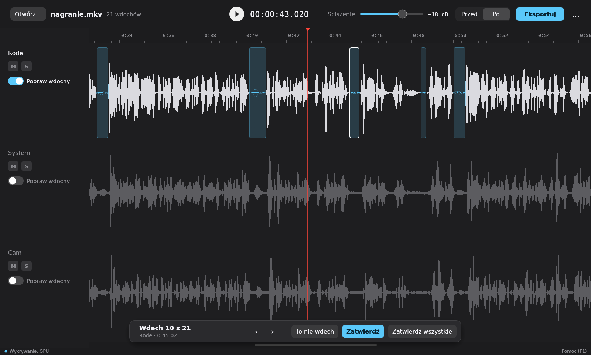

# Oddech

Program do wykrywania i ściszania wdechów w nagraniach wideo. Otwiera plik z kilkoma ścieżkami audio, znajduje wdechy na wybranych ścieżkach i pozwala je przejrzeć. Wynik to nowe wideo albo pliki WAV ze ściszonymi wdechami, albo gotowa, pocięta oś czasu do programu montażowego. Oryginalne nagranie nie jest zmieniane.



## Jak używać

1. **Otwórz nagranie:** „Otwórz…”, przeciągnij plik do okna (tylko X11) albo podaj go przy uruchomieniu.
2. **Wybierz ścieżkę z mową:** włącz „Popraw wdechy” w jej nagłówku. Wykrywanie uruchomi się samo i trwa kilka sekund.
3. **Przejrzyj wdechy** paskiem na dole: ‹ › przechodzą między wdechami, „Zatwierdź” lub „To nie wdech” rozstrzyga pojedynczy, „Zatwierdź wszystkie” resztę. Brakujący wdech zaznacz myszą na ścieżce i kliknij „+ Dodaj wdech”.
4. **Ustaw ściszenie** suwakiem na górze i porównaj „Przed” / „Po”.
5. **Eksportuj:** „Eksportuj” zapisuje wideo lub pliki WAV (format w „Więcej opcji”), a „Więcej opcji → Oś czasu do montażu” zapisuje FCPXML do DaVinci Resolve.

Poprawki zapisują się automatycznie obok nagrania. Skróty klawiszowe i dokładny opis działania funkcji: klawisz F1 w programie.

## Instalacja

Wymagania: Linux x86-64, X11 lub Wayland. Opcjonalnie karta graficzna NVIDIA do akceleracji.

Paczki są na stronie [wydań](https://github.com/k-nowicki/oddech/releases/latest).

**Debian, Ubuntu i pochodne** (od Ubuntu 22.04 / Debiana 12):

```bash
sudo apt install ./oddech_1.0.1_amd64.deb
```

Program pojawia się w menu jako „Oddech”; z terminala: `oddech [nagranie.mkv]`.

Wykrywanie na karcie NVIDIA (sterownik 525 lub nowszy) daje dodatkowa paczka z bibliotekami CUDA i cuDNN (ok. 1,3 GB do pobrania, 2,9 GB po instalacji):

```bash
sudo apt install ./oddech-cuda_1.0.1_amd64.deb
```

Bez tej paczki, bez karty NVIDIA albo gdy karta nie przejdzie testu przy starcie, program używa wyłącznie CPU (wykrywa ok. 2 razy wolniej). Pokazuje to wskaźnik na pasku stanu na dole okna.

**Inne dystrybucje (AppImage):**

```bash
chmod +x Oddech-1.0.1-x86_64.AppImage
./Oddech-1.0.1-x86_64.AppImage [nagranie.mkv]
```

AppImage potrzebuje FUSE (`fusermount3` albo `fusermount`); bez niego działa z opcją `--appimage-extract-and-run`. Resztę bierze z systemu (niżej).
Jeśli trafisz na błąd: `fuse: memory allocation failed`
Oznacza to, że potrzebujesz zaktualizować AppImageLaunchera do wersji 3.x.
AppImageLauncher w wersji 2.x nie działa z obecną wersją appimage Oddechu.

### Wymagania systemowe

Paczki zawierają FFmpeg 8.1 (avcodec, avformat, avutil, swresample), ONNX Runtime 1.22 i model Respiro-en. Z systemu potrzebne są:

| Do czego | Debian / Ubuntu | Arch |
|---|---|---|
| biblioteka C (glibc 2.35 lub nowsza) | `libc6` | `glibc` |
| dźwięk (ALSA; PipeWire i PulseAudio przez wtyczkę ALSA) | `libasound2` | `alsa-lib` |
| okno na X11 | `libx11-6 libxcursor1 libxi6 libxrandr2 libxkbcommon0 libxkbcommon-x11-0` | `libx11 libxcursor libxi libxrandr libxkbcommon libxkbcommon-x11` |
| okno na Waylandzie | `libwayland-client0 libwayland-cursor0 libwayland-egl1` | `wayland` |
| rysowanie: Vulkan (loader i sterownik), bez niego OpenGL (EGL, sterowniki Mesa) | `libvulkan1 mesa-vulkan-drivers libegl1` | `vulkan-icd-loader`, sterownik (`vulkan-intel`, `vulkan-radeon`, `nvidia-utils`; bez karty `vulkan-swrast`), `libglvnd` |
| okna wyboru plików: portal XDG, a bez niego zenity | `libdbus-1-3 xdg-desktop-portal` (i backend pulpitu) albo `zenity` | `dbus xdg-desktop-portal` (i backend, np. `xdg-desktop-portal-gtk`) albo `zenity` |
| czcionki (opcjonalnie; bez nich wbudowane) | `fonts-dejavu-core` | `ttf-dejavu` |

Wykrywanie na karcie NVIDIA: sterownik 525 lub nowszy (w `.deb` z paczką `oddech-cuda`; AppImage wykrywa tylko na procesorze).

## Uruchamianie ze źródeł

Opis dla Debiana i Ubuntu; na innych systemach potrzebne są odpowiedniki tych pakietów.

**1. Narzędzia i biblioteki**

```bash
sudo apt install build-essential pkg-config clang libclang-dev libasound2-dev libavcodec-dev libavformat-dev libavutil-dev git
```

```bash
curl --proto '=https' --tlsv1.2 -sSf https://sh.rustup.rs | sh
```

Ze źródeł program korzysta z systemowego FFmpeg (sprawdzone wersje 6.1 i 8.1). Do testów potrzebne jest też polecenie `ffmpeg`.

**2. Katalog aplikacji `dist/`** — model i biblioteki, które program ładuje w czasie działania:

```
dist/
  lib/      ONNX Runtime 1.22
  models/   respiro-en.onnx
```

- `dist/lib/`: `libonnxruntime.so*` i `libonnxruntime_providers_shared.so` z paczki `onnxruntime-linux-x64-gpu-1.22.0` (wydania ONNX Runtime na GitHubie); do pracy na karcie NVIDIA także `libonnxruntime_providers_cuda.so` oraz systemowe CUDA 12 i cuDNN 9 (np. `nvidia-cuda-toolkit libcudnn9-cuda-12`).
- `dist/models/respiro-en.onnx`: kopia modelu z repozytorium:

```bash
mkdir -p dist/models && cp models/respiro-en.onnx dist/models/
```

`models/respiro-en.onnx` to eksport modelu [Respiro-en](https://github.com/ydqmkkx/Respiro-en) do ONNX. Odtworzenie go (wymaga [uv](https://docs.astral.sh/uv/)):

```bash
git clone https://github.com/ydqmkkx/Respiro-en training/vendor/Respiro-en
uv venv training/.venv && uv pip install --python training/.venv/bin/python -r training/requirements.txt
training/.venv/bin/python training/export_respiro_onnx.py
```

**3. Budowanie i start**

```bash
cargo build --release
```

```bash
./target/release/oddech [nagranie.mkv]
```

Transkrypcja mowy (whisper.cpp z CUDA) nie jest potrzebna do wykrywania i domyślnie nie jest budowana; włącza ją `--features whisper` (wymaga dodatkowo `cmake`, `g++-12` i `nvidia-cuda-toolkit`).

### Paczki instalacyjne

```bash
packaging/build.sh
```

Buduje `.deb`, AppImage i paczkę `oddech-cuda` w kontenerze z Ubuntu 22.04 (najstarszy obsługiwany system: paczka zbudowana na nim działa też na nowszych). Wymaga `podman` albo `docker`. FFmpeg, ONNX Runtime, biblioteki NVIDIA (ok. 2,6 GB; `--no-cuda` pomija je razem z paczką `oddech-cuda`) i narzędzia AppImage pobiera w wersjach przypiętych w `packaging/versions.sh` (z sumami kontrolnymi) do `packaging/cache/`; wynik trafia do `packaging/out/`.

### Wydania

Wydanie buduje GitHub Actions (`.github/workflows/release.yml`) po wypchnięciu taga `vX.Y.Z` zgodnego z wersją w `Cargo.toml`: uruchamia `packaging/build.sh` i publikuje paczki z sumami SHA-256 jako wydanie tego taga. Tag z przyrostkiem (`vX.Y.Z-rc1`) daje wydanie próbne (pre-release).

1. Nowa wersja w `Cargo.toml` (`[workspace.package]`) i w nazwach plików w „Instalacja”; `cargo build` aktualizuje `Cargo.lock`.
2. Commit, potem `git tag vX.Y.Z && git push origin main vX.Y.Z`.

Pliki pobierane przez `build.sh`, które znikają ze źródła (kompilacje FFmpeg), workflow kopiuje do wydania `build-deps`; `build.sh` korzysta z tej kopii, gdy źródła już nie ma.

## Dodatkowe informacje

**Gdzie program trzyma dane**

| Co | Gdzie |
|---|---|
| Poprawki nagrania, kopia referencyjna | obok nagrania: `<nagranie>.oddech.json`, `<nagranie>.oddech.reference.json` |
| Ustawienia | `~/.config/oddech/settings.json` |
| Dziennik (bieżące i poprzednie uruchomienie) | `~/.local/state/oddech/oddech.log`, `oddech.log.1` |
| Zdekodowany dźwięk (pamięć podręczna) | `~/.cache/oddech/`, limit w „Więcej opcji” |
| Model i biblioteki | `lib/` i `models/` obok programu (w wersji ze źródeł: `dist/`) |

**Zmienne środowiskowe**

| Zmienna | Działanie |
|---|---|
| `ODDECH_HOME` | inny katalog aplikacji (z `lib/` i `models/`) |
| `ORT_DYLIB_PATH` | inna biblioteka `libonnxruntime.so` |
| `ODDECH_CACHE_DIR` | inny katalog pamięci podręcznej |
| `ODDECH_CPU=1` | wykrywanie na procesorze mimo dostępnej karty |
| `RUST_LOG=debug` | szczegółowy dziennik, m.in. pełne komunikaty błędów GPU |

**Dokumentacja projektu:** wymagania w [SPEC.md](SPEC.md), decyzje techniczne i ich uzasadnienia w [DECISIONS.md](DECISIONS.md), narzędzia do pomiarów jakości wykrywania w [training/](training/).

Testy: `cargo test --workspace`.

Licencja: MIT ([LICENSE](LICENSE)). Licencje dołączonych składników są w paczkach w katalogu `licenses/`.
